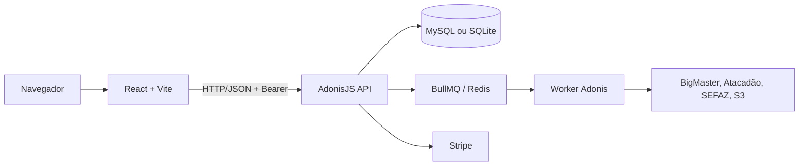

# Contexto técnico do projeto — EconomiaAtacado

> Documento de referência para desenvolvedores e assistentes de IA. Baseado no código presente no repositório em 03/08/2026. Quando houver divergência, o código e as migrations são a fonte de verdade.

## 1. Propósito e escopo

**EconomiaAtacado** é um comparador de preços de supermercado, inicialmente entre **Atacadão** e **BigMaster**. O usuário pesquisa produtos, monta uma lista ou importa uma NFC-e, e o sistema estima o custo em cada mercado e a melhor divisão de compra. O produto também mantém séries de preços, encontra promoções, calcula um índice de cesta, permite alertas Pro e oferece administração de coletas e pareamentos.

Os dois catálogos são independentes. A equivalência entre produtos é inferida por similaridade de nome e armazenada em `product_matches`; portanto, duas linhas com nomes parecidos não devem ser tratadas como o mesmo produto sem consultar o pareamento.

## 2. Arquitetura



### Monorepo e pacotes

| Área | Caminho | Tecnologia / responsabilidade |
|---|---|---|
| Orquestração | raiz | npm workspaces e Turborepo 2 |
| Aplicação web | `apps/frontend` | React 19, TypeScript, Vite 8, Tailwind 4, Heroicons, Zustand e React Query |
| API e jobs | `apps/backend` | AdonisJS 7, TypeScript, Lucid/Knex, VineJS e Japa |
| Persistência | `apps/backend/database` | MySQL 8 ou SQLite (`DB_CONNECTION`) e migrations |
| Infra local | `docker-compose.yml` | somente Redis 7; o Compose **não** sobe MySQL |

### Fluxos de execução

- `npm run dev` na raiz inicia os workspaces pelo Turbo.
- Frontend: Vite normalmente em `5173`; usa `VITE_API_URL` ou `http://<host>:3334` como base.
- Backend: `npm run dev` em `apps/backend`; API na porta definida por `PORT`.
- Worker: `npm run worker` em `apps/backend`. É necessário para processar jobs BullMQ quando Redis está disponível.
- O frontend é uma SPA com navegação por estado em `App.tsx`, não por React Router.

## 3. Estrutura relevante

```text
apps/backend/
  app/controllers/     # adaptação HTTP; não concentra regras complexas
  app/services/        # comparação, sincronização, coleta, preços, storage e filas
  app/models/          # modelos Lucid
  app/middleware/      # autenticação, admin, Pro e rate limit
  app/config/plans.ts  # limites de planos
  commands/            # comandos Ace operacionais
  database/migrations/ # evolução versionada do banco
  start/routes.ts      # contrato HTTP central
  bin/worker.ts        # consumidor BullMQ
apps/frontend/src/
  api/client.ts        # contratos e chamadas à API
  contexts/AuthContext.tsx
  components/          # telas e componentes de domínio
  store/useShoppingListStore.ts
  App.tsx              # shell, sidebar e navegação visual
```

## 4. Telas e experiência

O `AuthProvider` restaura o token de `localStorage` (`produtos-app:auth-token`) consultando `/api/v1/account/profile`. Enquanto não há sessão, a interface exibe login ou cadastro. O token é enviado como `Authorization: Bearer <token>` nas chamadas autenticadas.

| Visão no `App.tsx` | Componente | O que faz |
|---|---|---|
| `welcome` | `WelcomeScreen` | Painel inicial: estatísticas por origem, índice de cesta, ofertas e comparação recente (`sessionStorage`). |
| `catalog` | `ProductCatalog`, `ProductTable`, `ProductPriceHistory` | Busca, filtros por catálogo/origem/categoria, grade/tabela e detalhes de histórico/insights. A paginação é feita no cliente após receber até 5.000 produtos. |
| `comparison` | `ComparisonDashboard` | Cria itens por nome/quantidade, chama comparação e guarda rascunhos locais; pode consumir listas persistidas. |
| `scanner` | `ReceiptScanner`, `QrCodeCamera`, `ReceiptResultCard` | Lê QR Code pela câmera ou imagem/manual, envia chave/URL de NFC-e e transfere itens ao comparador. O leitor usa `jsQR`. |
| `promotions` | `PromotionsScreen` | Lista promoções por período, origem/categoria e permite adicionar à comparação. |
| `alerts` | `PriceAlertsScreen` | Cria/remove alertas de preço; exige assinatura Pro. |
| `admin` | `AdminScreen` | Saúde dos scrapers, pareamentos e gatilhos administrativos. Só aparece para `user.role === 'admin'`; a API também impõe a regra. |
| conta | `AccountPanel` | Mostra assinatura e inicia Checkout/Portal Stripe. |

`useShoppingListStore` contém um rascunho inicial de três itens e limita quantidade mínima a 1. `useJobPolling` consulta `GET /api/jobs/:jobId` a cada 2 segundos para jobs assíncronos.

## 5. Autorização, planos e regras transversais

### Papéis e plano

- `user` é o papel padrão; `admin` pode executar sincronizações e curar pareamentos.
- O plano padrão é `free`. Pro é válido somente quando `plan = 'pro'` **e** `status = 'active'`.
- Free pode manter no máximo **3** listas persistidas; Pro não possui limite.
- Alertas de preço exigem Pro.
- A configuração declara também limites de histórico, promoções e filtros para Free, mas eles não são aplicados uniformemente pelas rotas atuais. Não presuma bloqueio sem verificar o controller.
- Preço de referência Pro: R$ 10,00/mês (`1000` centavos) no código; Stripe usa `STRIPE_PRICE_ID_PRO` se presente.

### Isolamento de dados

Recibos e listas são consultados por `userId`; ações de leitura, alteração, remoção e comparação de lista verificam a propriedade. A tabela `receipts` tem unicidade global em `chave_acesso`, embora o controller procure duplicidade por usuário: importar a mesma nota por contas diferentes pode esbarrar nessa restrição.

### Proteções

- Rotas administrativas: Bearer válido + `role = admin`.
- Sincronizações administrativas: cooldown de 120 segundos por usuário/IP e URL; usa Redis e cai para memória se Redis estiver indisponível.
- CORS é aberto em desenvolvimento; em produção a allowlist atual contém apenas `http://localhost:5173` e deve ser revista antes da publicação.
- O token é persistido em `localStorage`; mudanças nessa decisão têm impacto de segurança e compatibilidade.

## 6. Modelo de dados

Colunas usam `snake_case`; propriedades dos modelos Lucid usam `camelCase`. Alterar dados estruturais requer migration: `database/schema.ts` é gerado e não deve ser editado manualmente.

| Tabela | Dados principais e relações |
|---|---|
| `users` | `email` único, senha com hash, `full_name`, `role`; 1:1 com assinatura. |
| `auth_access_tokens` | tokens Bearer de usuários; removidos no logout. |
| `subscriptions` | uma por usuário (`user_id` único); IDs Stripe, `plan`, `status`, fim de ciclo. |
| `products` | catálogo: `external_id` único, identificação, preço varejo/atacado, mínimo atacado, disponibilidade, origem, categorias, imagem, unidade normalizada e preço de referência. |
| `price_history` | snapshots de preço/disponibilidade com `capturado_em`; N:1 com produto. |
| `price_daily` | um registro por produto/dia; preço varejo/atacado, disponibilidade e fonte `captura` ou `forward_fill`. |
| `product_matches` | par Atacadão–BigMaster único, `score`, status `auto`, `manual` ou `rejected`. |
| `shopping_lists` / `shopping_list_items` | listas por usuário e itens de nome, quantidade e preço original opcional. |
| `receipts` | NFC-e: chave, estabelecimento, total, metadados e `itens` serializado como JSON; pode pertencer a usuário. |
| `scraper_runs` | auditoria de fonte, sucesso/falha, quantidade, erro e duração. |
| `basket_index` | índice diário por origem e número de produtos considerados. |
| `price_alerts` | usuário/produto, tipo `abaixo_de` ou `qualquer_queda`, preço alvo opcional, ativo e último disparo. |

### Relações e histórico

- O catálogo identifica a fonte por `products.origem` (`atacadao` ou `bigmaster`). IDs externos são prefixados na sincronização.
- O histórico é gravado quando sincronizações detectam mudança de preço/disponibilidade. A série diária é uma consolidação separada, usada por insights e promoções.
- `products:parse-units` extrai peso, volume e packs do nome para `quantidade_base` em `g`, `ml` ou `un`; não altera preço.

## 7. Regras de negócio e serviços

### Comparação e pareamento

`PriceComparisonService` normaliza nomes, compara tokens e n-grams e penaliza/bonifica divergências de peso/volume. Para cada item informado:

1. procura o melhor produto disponível em cada origem;
2. calcula preço do Atacadão, aplicando `preco_atacado` somente se a quantidade atingir `quantidade_minima_atacado`; caso contrário usa varejo;
3. calcula BigMaster com o preço disponível;
4. retorna totais por mercado, itens sem correspondência e uma recomendação *split* que escolhe, item a item, o menor preço encontrado.

`recomputeMatches` calcula pares de catálogo e grava/atualiza sugestões automáticas, sem sobrescrever uma decisão manual ou rejeitada. Pareamento manual recebe `status = manual`; rejeição recebe `rejected`.

### Preço, promoção e cesta

- `PriceDailyService` consolida snapshots históricos em uma série diária e usa *forward fill* quando apropriado.
- `PromotionService` calcula referência com histórico de até 30 dias. Uma promoção é considerada quando o atual está pelo menos 10% abaixo da referência.
- `BasketIndexService` agrega produtos disponíveis por origem para compor o índice diário; a rota devolve séries de Atacadão e BigMaster.
- `PriceAlertService` avalia alertas ativos: `abaixo_de` dispara ao atingir o alvo; `qualquer_queda` considera redução contra o preço anterior. O serviço registra o disparo em log e atualiza `ultimo_disparo_em`; não há canal de notificação externo implementado nessa classe.

### Ingestão externa

- **BigMaster:** `BigMasterSyncService` busca a fonte configurada em `BIGMASTER_API_URL`, faz upsert no catálogo, registra histórico e pode baixar imagens. Se S3 estiver configurado usa `StorageService`; caso contrário pode usar armazenamento local.
- **Atacadão:** `AtacadaoScraperService` consulta a API GraphQL configurável e sincroniza categorias/produtos, mantendo histórico.
- **SEFAZ:** `SefazScraperService` extrai a chave de 44 dígitos de URL/entrada, realiza leitura e salva o cupom. `SCRAPER_MOCK_MODE=true` habilita dados simulados para desenvolvimento/QA.
- **Resiliência de jobs:** endpoints de sincronização de produtos tentam BullMQ; em algumas falhas de conexão fazem execução direta. Recibos e recomputação de matches são enfileirados e dependem de Redis/worker.

## 8. API HTTP

Salvo quando indicado, as rotas abaixo retornam JSON. Rotas protegidas exigem `Authorization: Bearer <token>`. Há dois prefixos: autenticação em `/api/v1` e funcionalidades em `/api`.

### Pública

| Método e rota | Parâmetros/body | Resultado |
|---|---|---|
| `GET /` | — | `{ hello: 'world' }`. |
| `GET /api/products` | `categoria1`, `categoria2`, `origem`, `busca` opcionais | até 5.000 produtos transformados e categorias distintas. |
| `GET /api/products/stats` | — | totais, categorias e última atualização por origem. |
| `GET /api/products/:id/history` | `periodo=7d\|30d\|90d\|tudo` | histórico pontual e resumo de mínimo/máximo/variação. |
| `GET /api/atacadao/categories` | — | conteúdo de `config/categories.json`. |
| `POST /api/compare` | `{ items: [{ nome, quantidade, precoOriginal? }] }` | totais e recomendação de comparação. |
| `GET /api/jobs/:jobId` | — | estado `queued`, `running`, `completed` ou `failed`, progresso e resultado. |
| `GET /api/scrapers/health` | — | painel de saúde baseado em `scraper_runs`. |
| `GET /api/basket-index` | `periodo` opcional | séries do índice de cesta. |
| `POST /api/webhooks/stripe` | evento Stripe | sincroniza assinatura; não usa Bearer. |

### Conta — `/api/v1`

| Método e rota | Acesso | Body / efeito |
|---|---|---|
| `POST /api/v1/auth/signup` | público | `fullName`, `email`, `password`, `passwordConfirmation`; cria usuário e token. |
| `POST /api/v1/auth/login` | público | `email`, `password`; valida credenciais e cria token. |
| `GET /api/v1/account/profile` | autenticado | retorna usuário transformado. |
| `POST /api/v1/account/logout` | autenticado | revoga o token corrente. |

### Usuário autenticado — `/api`

| Método e rota | Uso |
|---|---|
| `GET` / `POST /api/receipts` | lista cupons do usuário; POST recebe `chaveAcesso` ou `qrCodeUrl`, valida 44 dígitos e cria job SEFAZ. |
| `GET` / `POST /api/shopping-lists` | lista ou cria lista (`nome`, `items`). |
| `GET` / `PUT` / `DELETE /api/shopping-lists/:id` | lê, substitui dados/itens ou remove somente lista do usuário. |
| `POST /api/shopping-lists/:id/compare` | compara itens da lista persistida. |
| `GET /api/subscriptions/me` | cria/retorna assinatura e limites efetivos. |
| `POST /api/subscriptions/checkout` | inicia Checkout; aceita `successUrl` e `cancelUrl`. Em desenvolvimento sem chave Stripe, simula Pro. |
| `POST /api/subscriptions/portal` | cria sessão do portal Stripe. |
| `GET /api/promotions` | filtros `periodo`, `categoria`, `origem`, `limite`; cache em memória de 15 min. |
| `GET /api/products/:id/insights` | série diária, produto pareado e métricas; aceita `periodo`. |
| `GET` / `POST` / `DELETE /api/price-alerts[/:id]` | somente Pro; cria com `productId`, `tipo` e, quando aplicável, `precoAlvo`. |
| `GET` / `POST /api/matches` | lista filtros `status`/`minScore` ou cria/sobrescreve match manual. |
| `PATCH /api/matches/:id/reject` | rejeita pareamento. |
| `POST /api/matches/recompute` | enfileira novo pareamento automático. |

### Administração — `/api/admin`

Todas requerem token, papel admin e estão sujeitas a rate limit.

| Método e rota | Body / efeito |
|---|---|
| `POST /api/admin/scrape` | `categoria1`, `categoria2`, `maxPaginas?`; scrape de categoria Atacadão. |
| `POST /api/admin/atacadao/sync-all` | `maxPaginas?`, `delayMs?`; sincronização de catálogo. |
| `POST /api/admin/bigmaster/sync` | dispara sincronização BigMaster. |
| `POST /api/admin/bigmaster/sync-images` | sincroniza/copia imagens do BigMaster. |

## 9. Fila, comandos e observabilidade

Jobs de `sync-tasks`: `atacadao_sync_all`, `atacadao_scrape`, `bigmaster_sync`, `bigmaster_sync_images`, `sefaz_scrape` e `recompute_product_matches`. O worker trata ainda consolidação diária e recálculo de referência; se criar novo job, registre o tipo e o `case` em `bin/worker.ts`.

| Comando Ace | Finalidade |
|---|---|
| `node ace migration:run` | aplica migrations. |
| `node ace test` | executa Japa. |
| `node ace price:consolidate --dias=30` | gera/backfill de `price_daily`. |
| `node ace products:parse-units` | normaliza unidades do catálogo. |
| `node ace sync:atacadao` / `node ace sync:bigmaster` | sincronizações diretas. |
| `node ace user:make-admin <email>` | promove uma conta. |
| `node ace test:scraper [url]` | roteiro manual de teste SEFAZ; não usar como teste automático. |

`ScraperHealthService` registra execuções e alerta após falhas consecutivas (webhook configurável). `SentryService` sempre escreve log estruturado; com `SENTRY_DSN`, tenta envio HTTP simples.

## 10. Variáveis de ambiente e integrações

Obrigatórias pelo validador: `NODE_ENV`, `PORT`, `HOST`, `LOG_LEVEL`, `APP_KEY`, `APP_URL`, `SESSION_DRIVER` e `DB_CONNECTION`. Para MySQL configure `DB_HOST`, `DB_PORT`, `DB_USER`, `DB_PASSWORD`, `DB_DATABASE`; SQLite usa arquivo temporário da aplicação.

| Grupo | Variáveis principais |
|---|---|
| Coletas | `SCRAPER_MOCK_MODE`, `BIGMASTER_API_URL`, `ATACADAO_GRAPHQL_URL`, `ATACADAO_REGION_ID`, `ATACADAO_SELLER` |
| Fila | `REDIS_HOST`, `REDIS_PORT`, `REDIS_URL` |
| Storage | `S3_BUCKET`, `S3_REGION`, `S3_ENDPOINT`, `S3_PUBLIC_URL`, `AWS_ACCESS_KEY_ID`, `AWS_SECRET_ACCESS_KEY` |
| Pagamentos | `STRIPE_SECRET_KEY`, `STRIPE_PRICE_ID_PRO`, `STRIPE_WEBHOOK_SECRET` |
| Observabilidade | `SENTRY_DSN` |

Nunca coloque valores reais no repositório ou neste documento.

## 11. Convenções para mudanças seguras

1. Comece pelo contrato: toda rota nova deve ser declarada em `apps/backend/start/routes.ts`, com middleware coerente, e exposta no cliente se houver UI.
2. Crie migration para qualquer evolução de banco; não altere `database/schema.ts` manualmente.
3. Deixe controllers finos e scrapers/algoritmos em `app/services`. Não misture alteração de scraper e API sem necessidade.
4. Ao criar job, atualize o tipo de `SyncJobData`, o produtor e o `switch` do worker.
5. Preserve os nomes em português no domínio e a conversão snake_case/camelCase.
6. Teste serviços e endpoints com Japa. Para scrapers use fixtures em `apps/backend/tests/fixtures`; evite coleta real durante depuração por bloqueios externos.
7. Valide mudanças de Pro, admin ou propriedade de dados tanto na interface quanto no backend; a segurança reside no middleware/controller.
8. Antes de publicar, revise CORS, Stripe, Redis/worker e as variáveis de produção.

## 12. Pontos de atenção para LLMs

- Não invente campos, endpoints, canais de alerta ou integrações. As listas não têm `target_market` nem totais armazenados, e `basket_index` não guarda totais por mercado.
- A API usa `/api/v1` somente para autenticação/conta; a maior parte usa `/api`.
- `price_history` e `price_daily` atendem propósitos distintos: o primeiro é captura pontual; o segundo é série consolidada.
- Produtos são localizados principalmente por nome no comparador. Matching é probabilístico; resultados e limiares precisam ser tratados como sugestões, não identidade garantida.
- Jobs podem retornar `202` e precisar de polling. Não assuma que uma sincronização terminou ao receber a resposta de criação do job.
- Há alterações locais não versionadas no repositório no momento da geração deste documento. Revise `git status` antes de criar commit ou sobrescrever arquivos.
